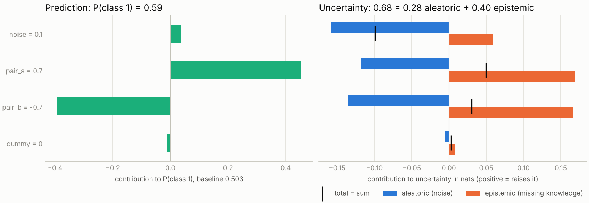
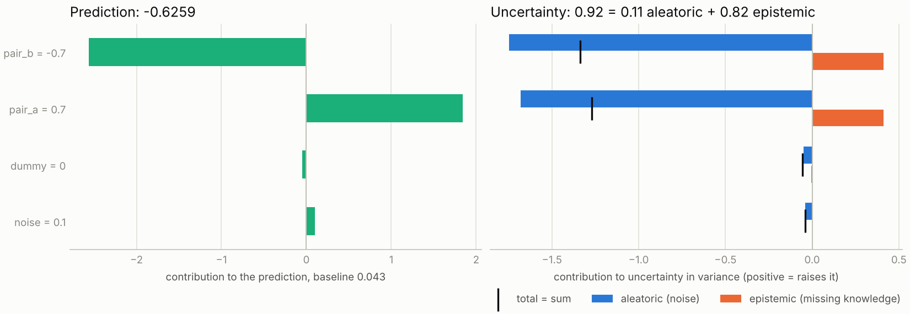
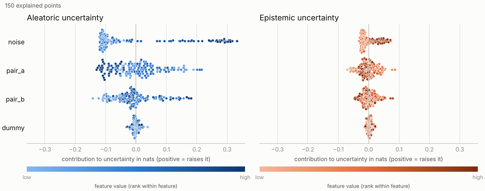

# shapiq-probly

**Leitfrage:** Welche Merkmale machen ein Modell unsicher, und ist diese Unsicherheit Rauschen in den Daten (aleatorisch) oder fehlendes Wissen (epistemisch)?

Die Library formuliert Unsicherheitsmaße als Wertfunktion eines kooperativen Spiels über Merkmale: v(S) ist die Unsicherheit, wenn nur die Merkmale in S bekannt sind. Shapley-Werte und Interaktionen der drei Spiele (total, aleatorisch, epistemisch) erklären dann, welches Merkmal Rauschen und welches eine Wissenslücke beiträgt. Weil TU = AU + EU für jede Koalition gilt und alle Indizes linear im Spiel sind, gilt auch φ(TU) = φ(AU) + φ(EU).

```python
from shapiq_probly import explain_uncertainty, plot_uncertainty_profile

expl = explain_uncertainty(ensemble_model, x, background=X_train)  # Klassifikation oder Regression
print(expl.summary())
plot_uncertainty_profile(expl)
```



## Installation

```bash
pip install -e ".[dev]"          # Kern + Tests + Plots
pip install -e ".[dev,shapiq]"   # zusätzlich die shapiq-Brücke
pip install -e ".[dev,torch]"    # zusätzlich die torch-Brücke
pytest
python examples/quickstart.py           # Klassifikation, synthetischer Benchmark
python examples/extensions.py           # Regression, Dropout, Credal, Conformal, OOD, global
python examples/regression_diabetes.py  # Regression auf echten Daten
```

Python ≥ 3.12. Der Kern braucht nur numpy, scipy und scikit-learn. Die Beispiele schreiben ihre Bilder nach `examples/output/`.

## Stand: was geprüft ist und was nicht

| Teil | Status |
|---|---|
| Kern, Regression, MC Dropout auf sklearn-MLPs, Credal, Conformal, OOD, globale Plots | 149 Tests grün (numpy/sklearn) |
| `shapiq_bridge` | Auf GitHub-CI gegen shapiq 1.8.0 geprüft: Vergleich mit `shapiq.ExactComputer` und Additivität mit shapiq-Arithmetik bestehen (Stand v0.1). Der neue Test für skalare Spiele ist dort noch nicht gelaufen. |
| `torch_bridge` (`from_torch_dropout`, `from_torch_ensemble`) | **nie ausgeführt**, torch war in der Entwicklungsumgebung nicht installierbar. `tests/test_torch_bridge.py` läuft im CI-Job `dev,torch`; erst wenn der grün ist, gilt das Modul als geprüft. |
| `probly_bridge` (`from_probly`) | **Skizze**. Form und Typ von `representer.represent(x)` sind nicht verifiziert; die Schritte zum Fertigstellen stehen im Modul-Docstring. |

Alle Unsicherheitsmaße sind eigene Implementierungen, die die probly-Zerlegungen nachbilden (`SecondOrderEntropyDecomposition`, `SecondOrderVarianceDecomposition`, `CredalSetEntropyDecomposition`). Conformal und OOD nutzen ebenfalls eigenen Code, nicht `probly.conformal` oder `probly.evaluation.ood`.

## Was die Library kann

| Frage | Aufruf | Ergebnis |
|---|---|---|
| Welche Merkmale treiben AU und EU? (Klassifikation) | `explain_uncertainty(model, x, X_train)` | `UncertaintyExplanation` |
| Dasselbe für Regression | wie oben, die Aufgabe wird am Modell erkannt | Varianz-Zerlegung |
| Dasselbe mit MC Dropout | `explain_uncertainty(mc_dropout_sklearn(mlp), x, X_train)` | Dropout-Masken als Member |
| Welche Merkmale machen das Credal Set breit? | `explain_uncertainty(..., measure="credal")` | obere minus untere Entropie |
| Welche Merkmale blähen das Vorhersage-Set auf? | `explain_set_size(model, x, X_train, (X_cal, y_cal))` | `ScalarExplanation` |
| Welche Merkmale machen den Punkt untypisch? | `explain_ood(x, X_train)` oder `score=eigene_funktion` | `ScalarExplanation` |
| Was treibt die Unsicherheit im ganzen Datensatz? | `UncertaintyExplainer(...).explain_many(X)` und `plot_uncertainty_beeswarm` | globale Plots |
| Beliebige eigene Größe erklären | `explain_game(ScalarGame(x, X_train, value=...))` | `ScalarExplanation` |

Ein Modell ist alles, was sich in eine Funktion `X -> (M, n, C)` (Klassenwahrscheinlichkeiten pro Member) oder `X -> (M, n, 2)` (Mittelwert und Varianz pro Member) bringen lässt: sklearn-Ensembles, Listen von Modellen, Dropout-Masken, eigene Funktionen.

## Aufbau

| Modul | Inhalt |
|---|---|
| `adapters` | Modell → Member-Vorhersagen. sklearn-Ensembles für Klassifikation und Regression. Regressionsbäume liefern Blattmittel und Blattvarianz. |
| `dropout` | MC Dropout auf fertig trainierten sklearn-MLPs mit festen Masken pro Member. |
| `torch_bridge` | Deep Ensembles und MC Dropout für torch (ungeprüft, siehe oben). |
| `imputation` | `"marginal"`, `"gaussian"`, `"knn"` (empirisch bedingt). Gemeinsame Zufallszahlen für alle Koalitionen. |
| `measures` | Zerlegungen `"entropy"`, `"variance"`, `"credal"`; erweiterbar über `Measure`. |
| `games` | `UncertaintyGame` (ein Imputationsdurchlauf, vier Spiele, Cache) und `ScalarGame` für einwertige Größen. |
| `conformal`, `ood` | `ConformalSetSizeGame`, `OODGame`, `KNNDistanceScore`. |
| `exact` | Möbius, SV, SII, k-SII aus allen 2^n Werten; Permutations-Sampling als Fallback. |
| `explainer` | `explain_uncertainty`, `explain_set_size`, `explain_ood`, `explain_game`, `UncertaintyExplainer`. Exakt bis 12 Merkmale, darüber Shapley-Näherung mit Warnung. |
| `explanation` | `UncertaintyExplanation`, `ScalarExplanation`, `global_importance`; `summary()`, `check_additivity()`, `top_interactions()`, JSON. |
| `plots` | lokal: `plot_uncertainty_explanation`, `plot_uncertainty_profile`, `plot_interaction_network`, `plot_scalar_explanation`; global: `plot_uncertainty_beeswarm`, `plot_global_importance`. |
| `synthetic` | Benchmark mit Ground Truth für Klassifikation und Regression. |
| `shapiq_bridge`, `probly_bridge` | Brücken zu den beiden Bibliotheken. |

## Designfragen und Standardwerte

| Frage | Option | Standard |
|---|---|---|
| D1 Reihenfolge von Mitteln und Messen | `aggregation="member_mean"` (A), `"pointwise"` (B), `"pooled"` (C) | A |
| D2 Imputation | `imputer="marginal"`, `"gaussian"`, `"knn"` | marginal |
| D3 Vorzeichen | `mode="uncertainty"` (v = U(S)) oder `"information_gain"` (v = U(∅) − U(S)) | uncertainty |
| D5 Klassifikation und Regression | `measure="auto"`, `"entropy"`, `"credal"`, `"variance"` | auto |
| D6 Kosten | `max_exact_features`, `budget`, `n_samples` | 12, 200·d, 100 |

**D5, ein Mechanismus für beide Aufgaben:** „Verteilungen mitteln" ist für Klassenwahrscheinlichkeiten ein Mittelwert. Für Regression gilt dasselbe, wenn man jede Member-Vorhersage als rohe Momente (E[y], E[y²]) darstellt. Deshalb laufen A, B und C für Entropie und Varianz über denselben Code. Bei A wird jeder Member über die Imputationen zu einer Mischverteilung, deren Varianz die Streuung seiner Mittelwerte enthält.

## Was die Experimente zeigen

Alle Zahlen stammen aus einzelnen Läufen mit Seed 0 (Random Forest, 50 Bäume, `min_samples_leaf=10`), wenn nichts anderes dasteht.

### Klassifikation (synthetisch)

Am Punkt in der Lücke (beide Paarwerte einzeln normal, Kombination nie gesehen) ist `pair_a x pair_b` die stärkste epistemische Interaktion:

| EU-Interaktion des Paars (k-SII, Ordnung 2) | marginal | knn |
|---|---|---|
| Variante A (`member_mean`) | 0,22 | 0,29 |
| Variante B (`pointwise`) | 0,17 | 0,35 |

Mit bedingter Imputation (`knn`) ist die Interaktion klarer, weil marginale Imputation schon bei einem bekannten Paarwert Punkte in die Lücke legt (D2).

- **Baseline unter Variante A:** AU(∅) = 0,69 (Maximum bei zwei Klassen) und EU(∅) ≈ 0. Die Imputationsstreuung landet vollständig im aleatorischen Anteil. Aleatorische Beiträge sind dadurch meist negativ, und das Rauschmerkmal fällt am verrauschten Punkt nur relativ auf (SV +0,14 mit knn). Unter B ist AU(∅) = 0,24 und derselbe Wert +0,36.
- **Rauschen und Lücke interagieren:** Das Rauschmerkmal hat mit jedem Paarmerkmal eine epistemische Interaktion von ca. 0,08. Wo das Label reines Rauschen ist, sind sich alle Bäume einig; die Wissenslücke wird erst sichtbar, wenn bekannt ist, dass das Rauschen niedrig ist.

### Regression



- **Synthetisch, Punkt in der Lücke (knn):** Varianz 0,92 = 0,11 aleatorisch + 0,82 epistemisch. Die Interaktion `pair_a x pair_b` beträgt +0,81, erklärt also fast die gesamte epistemische Varianz. Das Bild ist sauberer als bei Klassifikation, weil additives Rauschen die Lücke nicht verdeckt.
- **Dieselbe Baseline-Eigenschaft wie oben:** Unter A ist AU(∅) = 3,62 und liegt damit in der Größenordnung der Varianz des Zielwerts (3,35). Die Paarmerkmale bekommen deshalb große negative aleatorische Beiträge (−1,7): Sie „erklären" Varianz, die kein Rauschen ist.
- **Diabetes (442 Patienten, 10 Merkmale):** `bmi` und `s5` sind global die größten Treiber beider Anteile. Das Modell ist schwach (R² 0,27 auf dem Test-Split, 0,45 in 5-facher Kreuzvalidierung), die Unsicherheiten sind entsprechend groß.
- **Aleatorische Varianz braucht Member mit Varianz:** Bäume liefern die Blattvarianz, `BayesianRidge` und Gauß-Prozesse ihre eigene. Modelle mit reiner Punktvorhersage haben am vollständigen Punkt AU = 0.

### MC Dropout

Am Punkt in der Lücke: EU = 0,22, stärkste epistemische Interaktion wieder `pair_a x pair_b` (+0,13). Jede Maske ist ein fester Member für alle Eingaben. Das ist nötig: Mit frischen Masken pro Zeile mittelt Variante A über die Masken, und die epistemische Unsicherheit verschwindet (im Versuch 0,001 statt 0,22).

sklearn trainiert nicht mit Dropout. `mc_dropout_sklearn` legt die Masken erst bei der Vorhersage an und ist deshalb ein testbarer Stellvertreter, kein Ersatz für ein mit Dropout trainiertes Netz.

### Credal Sets

Das Credal Set ist die konvexe Hülle der Member-Verteilungen: TU = obere Entropie, AU = untere Entropie, EU = Differenz. Am Punkt in der Lücke ergibt das AU = 0 und EU = 0,69 (ln 2). Bei 50 Bäumen gibt es fast immer einen Baum, der sich völlig sicher ist, also ist die untere Entropie 0. Die Hülle vieler Member misst die größtmögliche Uneinigkeit und ist damit deutlich gröber als die Entropie-Zerlegung.

### Conformal Prediction

Split Conformal mit α = 0,1: Abdeckung auf Testdaten 0,896, mittlere Set-Größe 1,13. Über sechs Seeds lag die Abdeckung zwischen 0,89 und 0,92.

- **Im Mittel stimmt die Ground Truth:** Über 40 Testpunkte, deren Set beide Klassen enthält, ist das Rauschmerkmal der größte Treiber (mittlerer Shapley-Wert +0,38 gegenüber +0,22 und +0,21 für die Paarmerkmale).
- **Einzelne Punkte sind bei zwei Klassen instabil:** Die Set-Größe ist 1 oder 2 und kippt bei Grenzfällen mit dem Seed. Der Punkt in der Lücke hatte in drei von sechs Seeds ein Zweier-Set, in den anderen ein Einer-Set. Für eine Fallstudie ist ein Datensatz mit mehr Klassen sinnvoller.
- Regression ist nicht abgedeckt.

### OOD

- **Ein verschobenes Merkmal** (`dummy` = 3 statt im Bereich [−1, 1]): Score 3,63 gegenüber 0,44 ohne bekannte Merkmale, `dummy` bekommt +3,23.
- **Die ungesehene Kombination:** Score 1,10 gegenüber 0,44; die Interaktion `pair_a x pair_b` beträgt +0,68, die Einzelbeiträge sind nahe 0. Der Punkt ist nur als Kombination untypisch.

Der eingebaute Score ist modellunabhängig (mittlerer Abstand zu den 10 nächsten Trainingspunkten). Eigene Scores wie ein Isolation Forest lassen sich als Funktion übergeben.

### Global



Jeder Punkt ist ein erklärter Datenpunkt, die Farbe zeigt den Merkmalswert. Hohe Werte von `noise` treiben die aleatorische Unsicherheit, `dummy` bleibt bei 0. Das Beispiel nutzt Variante B, weil deren Baseline die mittlere Unsicherheit auf den Daten ist; mit A sind die Bilder schwerer zu lesen.

## Mit shapiq

```python
import shapiq
from shapiq_probly import UncertaintyGame
from shapiq_probly.shapiq_bridge import as_shapiq_game

game = UncertaintyGame(model, x, X_train)
eu_game = as_shapiq_game(game, "epistemic")  # ein shapiq.Game
values = shapiq.ExactComputer(game=eu_game, n_players=game.n_players)(index="k-SII", order=2)
```

Alle Notions, die aus demselben `UncertaintyGame` erzeugt werden, teilen sich den Koalitions-Cache. Skalare Spiele (`ConformalSetSizeGame`, `OODGame`) lassen sich genauso einpacken.

## Mit torch

```python
from shapiq_probly import explain_uncertainty
from shapiq_probly.torch_bridge import from_torch_dropout

predict = from_torch_dropout(net, n_samples=20, output="logits")  # net enthält nn.Dropout
expl = explain_uncertainty(predict, x, background=X_train)
```

## Übertrag in den probly-Fork

Das Paket ist so geschnitten, dass `src/shapiq_probly/` als `src/probly/explanation/` übernommen werden kann. Dort fehlen dann: `probly_bridge` gegen die echte Representer-Ausgabe fertigstellen, `measures` durch `probly.quantification.decomposition` ersetzen, Conformal und OOD an `probly.conformal` und `probly.evaluation.ood` anbinden, Tests nach probly-Konvention aufteilen.
