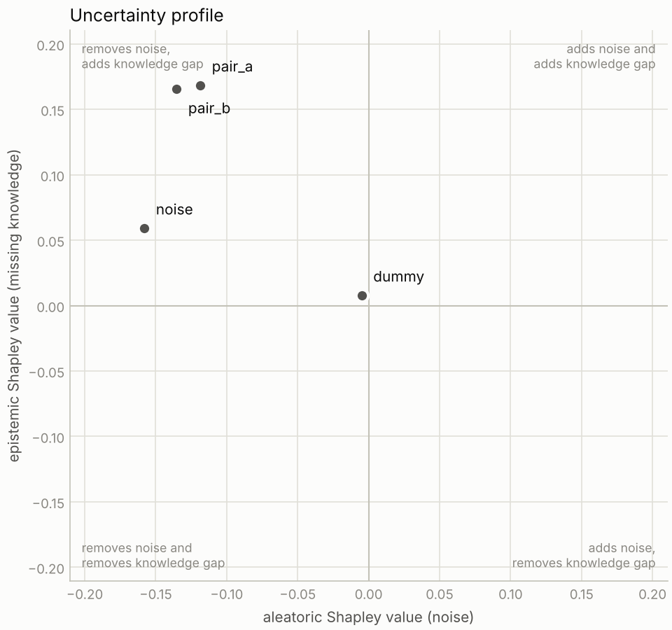
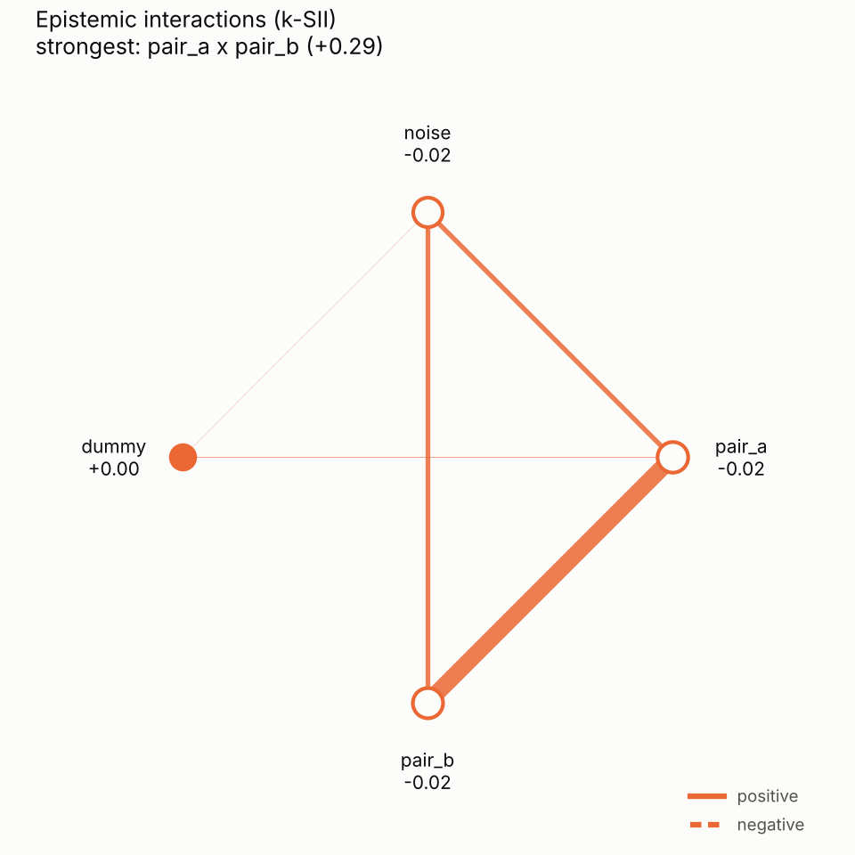

# shapiq-probly

**Leitfrage:** Welche Merkmale machen ein Modell unsicher, und ist diese Unsicherheit Rauschen in den Daten (aleatorisch) oder fehlendes Wissen (epistemisch)?

Die Library formuliert Unsicherheitsmaße als Wertfunktion eines kooperativen Spiels über Merkmale: v(S) ist die Unsicherheit, wenn nur die Merkmale in S bekannt sind. Shapley-Werte und Interaktionen der drei Spiele (total, aleatorisch, epistemisch) erklären dann, welches Merkmal Rauschen und welches eine Wissenslücke beiträgt. Weil TU = AU + EU für jede Koalition gilt und alle Indizes linear im Spiel sind, gilt auch φ(TU) = φ(AU) + φ(EU).

```python
from shapiq_probly import explain_uncertainty, plot_uncertainty_profile

expl = explain_uncertainty(ensemble_model, x, background=X_train)
print(expl.summary())
plot_uncertainty_profile(expl)
```


## Installation

```bash
pip install -e ".[dev]"          # Kern + Tests + Plots
pip install -e ".[dev,shapiq]"   # zusätzlich die shapiq-Brücke
pytest
python examples/quickstart.py    # schreibt Bilder nach examples/output/
```

Python ≥ 3.12. Der Kern braucht nur numpy, scipy und scikit-learn.

## Stand: was läuft, was nicht geprüft ist

| Teil | Status |
|---|---|
| Maße, Imputation, Spiel, exakte Indizes, Explainer, Ergebnisobjekt, Plots, synthetischer Benchmark | gebaut, 81 Tests grün (numpy/sklearn) |
| `shapiq_bridge` (`as_shapiq_game`, `to_interaction_values`) | nach der shapiq-1.8-Doku geschrieben, **nie ausgeführt**. `tests/test_shapiq_bridge.py` vergleicht mit `shapiq.ExactComputer` und wird ohne shapiq übersprungen. |
| `probly_bridge` (`from_probly`) | **Skizze**. Form und Typ von `representer.represent(x)` sind nicht verifiziert; die Schritte zum Fertigstellen stehen im Modul-Docstring. |
| Regression (Varianz-Zerlegung), MC Dropout, globaler Beeswarm, Conformal/OOD/Credal | nicht gebaut (Bauschritte 6–8) |

## Aufbau

| Modul | Schicht | Inhalt |
|---|---|---|
| `adapters` | 1 | Modell → Funktion `X -> (M, n, C)`: sklearn-Ensembles, Listen von Modellen, beliebige Callables. Ruft `predict_proba` selbst auf (keine Logits). |
| `imputation` | 2 | `"marginal"`, `"gaussian"`, `"knn"` (empirisch bedingt). Liefert nur imputierte Punkte, aggregiert nicht. Gemeinsame Zufallszahlen für alle Koalitionen. |
| `measures` | 3 | Entropie-Zerlegung TU / AU / EU, erweiterbar über ein Callable. |
| `games` | 3 | `UncertaintyGame`: ein Imputationsdurchlauf, vier Spiele (total, aleatoric, epistemic, prediction), Cache pro Koalition. |
| `exact` | 4 | Möbius, SV, SII, k-SII aus allen 2^n Werten; Permutations-Sampling als Fallback. |
| `explainer` | 4 | `explain_uncertainty`, `UncertaintyExplainer`. Exakt bis 12 Merkmale, darüber Shapley-Näherung mit Warnung. |
| `explanation` | 5 | `UncertaintyExplanation`: `.prediction`, `.total`, `.aleatoric`, `.epistemic`, `.shapley`, `.check_additivity()`, `.top_interactions()`, `.moebius()`, `.summary()`, JSON. |
| `plots` | 6 | `plot_uncertainty_explanation`, `plot_uncertainty_profile`, `plot_interaction_network`. |
| `synthetic` | 7 | Benchmark mit Ground Truth: Rauschmerkmal, Paar mit Lücke, Dummy. |

## Designfragen und Standardwerte

| Frage | Option | Standard |
|---|---|---|
| D1 Reihenfolge von Mitteln und Messen | `aggregation="member_mean"` (A), `"pointwise"` (B), `"pooled"` (C) | A |
| D2 Imputation | `imputer="marginal"`, `"gaussian"`, `"knn"` | marginal |
| D3 Vorzeichen | `mode="uncertainty"` (v = U(S)) oder `"information_gain"` (v = U(∅) − U(S)) | uncertainty |
| D6 Kosten | `max_exact_features`, `budget`, `n_samples` | 12, 200·d, 100 |

## Was der synthetische Benchmark zeigt

Random Forest (50 Bäume, `min_samples_leaf=10`), 4000 Punkte, exakte Berechnung. Die Zahlen stammen aus einem einzelnen Lauf mit Seed 0.

**N1 funktioniert.** Am Punkt in der Lücke (beide Paarwerte einzeln normal, Kombination nie gesehen) ist `pair_a x pair_b` die stärkste epistemische Interaktion:

| EU-Interaktion des Paars (k-SII, Ordnung 2) | marginal | knn |
|---|---|---|
| Variante A (`member_mean`) | 0,22 | 0,29 |
| Variante B (`pointwise`) | 0,17 | 0,35 |

Mit bedingter Imputation (`knn`) ist die Interaktion klarer, weil marginale Imputation schon bei einem bekannten Paarwert Punkte in die Lücke legt (D2).

**Zwei Beobachtungen, die man für die Verteidigung kennen sollte:**

- Unter Variante A ist AU(∅) = 0,69 (Maximum bei zwei Klassen) und EU(∅) ≈ 0. Die Imputationsstreuung landet vollständig im aleatorischen Anteil. Dadurch sind aleatorische Beiträge meist negativ, und das Rauschmerkmal fällt am verrauschten Punkt nur relativ auf (SV +0,14 mit knn). Unter Variante B ist AU(∅) = 0,24 und derselbe Wert +0,36.
- Das Rauschmerkmal interagiert auch epistemisch mit dem Paar (je ca. 0,08). Das ist kein Fehler: Wo das Label reines Rauschen ist, sind sich alle Bäume einig, die Wissenslücke wird also erst sichtbar, wenn bekannt ist, dass das Rauschen niedrig ist.




## Mit shapiq

```python
import shapiq
from shapiq_probly import UncertaintyGame
from shapiq_probly.shapiq_bridge import as_shapiq_game

game = UncertaintyGame(model, x, X_train)
eu_game = as_shapiq_game(game, "epistemic")  # ein shapiq.Game
values = shapiq.ExactComputer(game=eu_game, n_players=game.n_players)(index="k-SII", order=2)
```

Alle Notions, die aus demselben `UncertaintyGame` erzeugt werden, teilen sich den Koalitions-Cache.

## Übertrag in den probly-Fork

Das Paket ist so geschnitten, dass `src/shapiq_probly/` als `src/probly/explanation/` übernommen werden kann. Dort fehlen dann: `probly_bridge` gegen die echte Representer-Ausgabe fertigstellen, `measures` durch `probly.quantification.decomposition` ersetzen, Tests nach probly-Konvention aufteilen.
